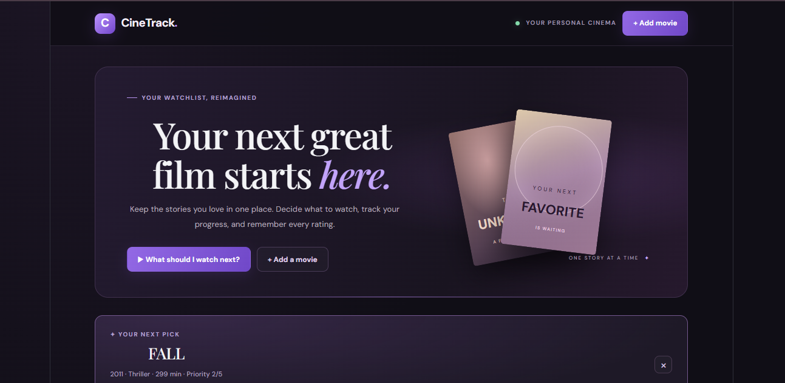
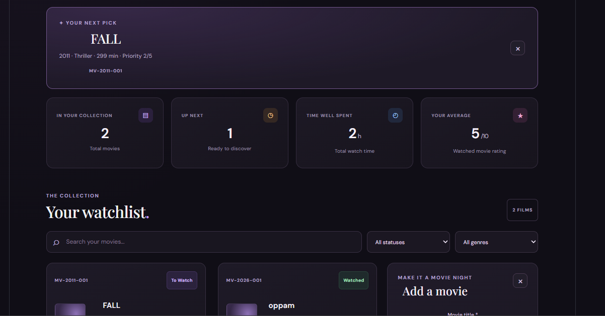
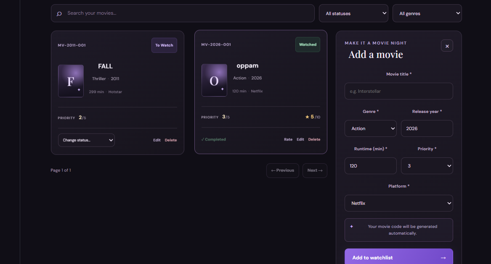

# CineTrack — Movie Watchlist Manager

A MERN stack application to manage movie watchlists, track viewing status, rate watched movies, and view statistics.

## Technologies
- React.js and CSS
- Node.js and Express.js
- MongoDB Atlas and Mongoose

## Setup

**Backend**
```bash
cd backend
npm install
npm run dev
```

**Frontend** (open a second terminal)
```bash
cd frontend
npm install
npm run dev
```

Configure `backend/.env` with your test MongoDB Atlas connection string and port `5000`.

## API Endpoints

| Method | Endpoint | Purpose |
|---|---|---|
| POST | `/api/movies` | Add a movie |
| GET | `/api/movies` | List, search, filter and paginate movies |
| GET | `/api/movies/:id` | Get a movie |
| PUT | `/api/movies/:id` | Edit a movie |
| PATCH | `/api/movies/:id/status` | Change movie status |
| PATCH | `/api/movies/:id/rating` | Update rating |
| DELETE | `/api/movies/:id` | Delete a movie |
| GET | `/api/movies/watch-next` | Recommend the next movie |
| GET | `/api/movies/stats` | Get dashboard statistics |

## Screenshots

### Dashboard


### Add Movie Form

